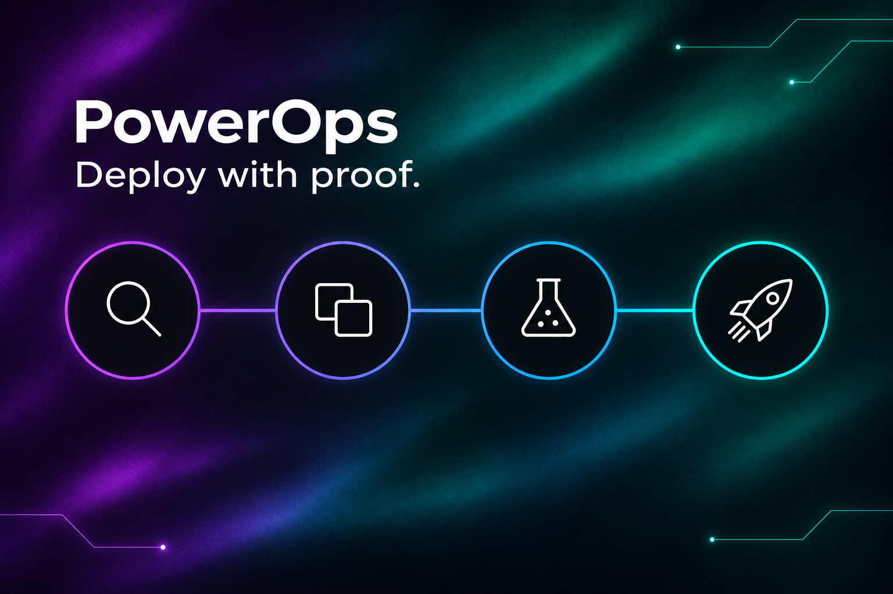

# PowerOps



Check, compare, test and deploy Microsoft Power Platform solutions from the command line.

PowerOps is a free, open-source toolkit for Windows and Linux. It works alongside `pac`; it does not replace it. It brings software-engineering discipline (analysis, diffing, testing, repeatable deployment) to Power Platform.

**Status:** early development, not yet released. The [commands](#commands) below are built.

## What it does

- Finds what would break a solution's import or a run, before you import it (`analyze`).
- Compares two versions of a solution, component by component (`diff`).
- Runs flow tests offline, with mocked connector actions (`test`).
- Says what importing solution zips would do to an environment (`deploy plan`), then imports only the plan you reviewed (`deploy apply`).
- Works from an AI agent in Claude Code or Codex, through planning skills and an MCP server.

## What you need

The .NET 10 SDK. `pac`, and `az` for `drift` and `deploy`, are needed only for the commands that read an environment.

## Install

### With your AI agent

Paste this into Claude Code, Codex or another coding agent. It installs the CLI and the skills, checks that they run, and tells you what is left for you.

```text
Install PowerOps (https://github.com/Chrome71/PowerOps), a CLI and agent skills for Microsoft
Power Platform. If a step fails, read https://github.com/Chrome71/PowerOps/blob/main/docs/INSTALL.md
1. Check that `dotnet --list-sdks` shows a 10.0 SDK (10.0.100 or later). If not, stop and tell me.
2. Clone the repo into a new temporary folder <clone> and install the CLI from that clone only:
   `dotnet pack <clone>/src/PowerOps.Cli -c Release -o <clone>/artifacts`, then
   `dotnet tool install --global --source <clone>/artifacts PowerOps`.
   If `powerops` is already installed, ask me before you uninstall it.
3. Add the skills for the agent you are running in. Claude Code:
   `claude plugin marketplace add Chrome71/PowerOps`, then `claude plugin install powerops@powerops`.
   Codex: `codex plugin marketplace add Chrome71/PowerOps`, then `codex plugin add powerops@powerops`.
   Any other agent: `powerops skills install` in my repo. Use the plugin or the repo copy, not both.
4. Run `powerops --version` and `powerops rules`; both must exit 0.
5. Tell me whether `pac` and `az` are on PATH: only the commands that read an environment need them.
Never ask me for, or handle, passwords, keys or tokens: I sign in to pac and az myself. Write
nothing to a Power Platform environment. Ask me before changing anything outside this install,
such as my PATH or shell profile. Last, report what you installed and what is left for me to do,
such as starting a new agent session so the plugin loads.
```

### Install it yourself

From a clone of this repo (needs the .NET 10 SDK):

```sh
dotnet pack src/PowerOps.Cli -c Release -o artifacts &&
  dotnet tool install --global --source artifacts PowerOps
powerops --version
```

Windows PowerShell 5.1 can't parse `&&`: there, run `dotnet pack` and `dotnet tool install` one at a time, the second only if the first succeeded.

Releases, checksums, updating and Windows notes are in [Install PowerOps](docs/INSTALL.md).

## Quick start

Run `analyze` where your solutions are. It finds the unpacked XML folders and exported `.zip` files under the current folder and reports what would break the import or a run:

```sh
powerops analyze
```

### Run it in CI

In any CI system that has the .NET 10 SDK, build PowerOps from a clone, then one command writes a SARIF report and fails the build on errors:

```sh
po="$(mktemp -d)"
git clone https://github.com/Chrome71/PowerOps.git "$po/PowerOps"
git -C "$po/PowerOps" checkout cbc31e7a059d83da172d30128c98f5152afcb6e8 # main on 2026-11-10; pin the newest commit of main
dotnet pack "$po/PowerOps/src/PowerOps.Cli" -c Release -o "$po/PowerOps/artifacts"
dotnet tool install --global --source "$po/PowerOps/artifacts" PowerOps
powerops analyze solutions --format sarif --out powerops.sarif # solutions: the folder that holds your solutions
```

On GitHub Actions, use the action: it writes a job summary and annotations, and uploads the findings to code scanning. The workflow, the merge gate for flow tests and the pull request comment are in [GitHub Action](docs/GITHUB-ACTION.md).

## Commands

| Command | What it does |
|---|---|
| [`analyze`](docs/COMMANDS.md#analyze-and-baseline) | Finds what would break a solution's import or a run ([rules](docs/rules/README.md)) |
| [`baseline`](docs/COMMANDS.md#analyze-and-baseline) | Accepts today's findings, so `analyze` reports only new ones |
| [`rules`](docs/COMMANDS.md#rules) | Lists every rule with its severity, title and fix |
| [`diff`](docs/COMMANDS.md#diff) | Compares two versions of a solution, component by component |
| [`manifest`](docs/COMMANDS.md#manifest) | Lists a solution's files with a SHA-256 for each and one digest, or compares two unpacked folders file by file |
| [`test`](docs/FLOW-TESTS.md) | Runs flow tests with mocked connector actions |
| [`settings generate`](docs/COMMANDS.md#settings-generate-and-settings-validate) | Writes `pac` deployment settings with empty values to fill in |
| [`settings validate`](docs/COMMANDS.md#settings-generate-and-settings-validate) | Finds missing, extra and empty entries in a settings file |
| [`settings apply`](docs/COMMANDS.md#settings-apply) | Imports a zip with a settings file and checks the flows are on |
| [`drift`](docs/COMMANDS.md#drift) | Compares one solution across environments or saved snapshots |
| [`deploy plan`](docs/COMMANDS.md#deploy-plan) | Says what importing solution zips would do to an environment |
| [`deploy apply`](docs/COMMANDS.md#deploy-apply) | Imports a reviewed plan; refuses if the target or files changed |
| [`deploy gate`](docs/COMMANDS.md#deploy-gate) | A hook check before Microsoft's import tools: allows only the plan's first import |
| [`plan status`](docs/COMMANDS.md#plan-and-skills) | Checks every plan under `docs/plans/` |
| [`plan sign-off`](docs/COMMANDS.md#plan-and-skills) | Writes the status, date and body hash into a plan's header |
| [`plan facts`](docs/COMMANDS.md#plan-and-skills) | Prints environment and solution names as JSON |
| [`skills install`](docs/COMMANDS.md#plan-and-skills) | Copies the agent skills into the repo |
| [`mcp`](docs/COMMANDS.md#mcp) | Runs an MCP server whose tools run these commands |

`settings apply`, `drift`, `deploy plan`, `deploy apply`, `deploy gate` and `plan facts` read an environment, so `pac` must be signed in, and `az` too for `drift` and `deploy` (`drift` can also compare saved snapshot files offline). The others work offline on files. Only `settings apply --apply` and `deploy apply --apply` write to an environment; without `--apply` they are dry runs.

Every option, output format and exit code is in the [command reference](docs/COMMANDS.md).

## Use it with an AI agent

PowerOps ships six agent skills: four turn an idea into a reviewed, signed-off plan, and two check the build against that plan and read it for security. It also ships an MCP server whose tools run the commands. Add the skills with `powerops skills install`, or install them as a plugin for Claude Code or Codex: see [Use from an agent](docs/USE-WITH-AGENTS.md). With Microsoft's power-platform-skills or Dataverse-skills, follow the [hand-off](docs/HANDOFF.md).

## Documentation

- [Command reference](docs/COMMANDS.md)
- [GitHub Action: merge gate and pull request comment](docs/GITHUB-ACTION.md)
- [Flow tests](docs/FLOW-TESTS.md)
- [Rules](docs/rules/README.md)
- [JSON schemas](docs/schemas/README.md)
- [Use from an agent: planning skills, plugin and MCP server](docs/USE-WITH-AGENTS.md)
- [Install: releases, checksums, updating, Windows notes](docs/INSTALL.md)
- [Hand-off to Microsoft's skills](docs/HANDOFF.md)
- [Recovery after an import that stops](docs/RECOVERY.md)
- [What an agent client must provide](docs/HARNESS.md)
- [Example workflows: Dev to Test promotion, an environment per pull request](docs/examples/README.md)
- [Planning skills design](docs/PLANNING-SKILLS.md)
- [Foundation plan and roadmap](docs/FOUNDATION.md)

## Contributing

See [CONTRIBUTING.md](CONTRIBUTING.md). Coding agents working on PowerOps itself read [AGENTS.md](AGENTS.md).

License: [Apache 2.0](LICENSE).
