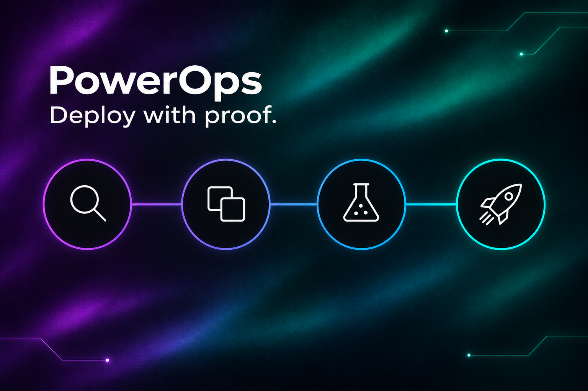

# PowerOps



Offline-first CLI and agent toolkit for Microsoft Power Platform on Windows and Linux. Works alongside `pac`—never replaces it.

**Status:** preview release.

## What it does

- **Analyze (`analyze`)** — catches import and runtime issues before deployment.
- **Diff (`diff`)** — compares two solution versions component by component.
- **Test (`test`)** — runs cloud flow tests offline with mocked connector actions.
- **Deploy (`deploy plan` / `deploy apply`)** — previews impact, then imports only a reviewed plan.
- **AI agents (`mcp` + skills)** — seven skills and a stdio MCP server for Claude Code and Codex.

## Install

Download `powerops-linux-x64` or `powerops-win-x64.exe` from the [latest release](https://github.com/Chrome71/PowerOps/releases/latest), verify `SHA256SUMS`, and place it on `PATH` as `powerops` (no .NET SDK required). See [Install PowerOps](docs/INSTALL.md) for checksums, Windows notes, updating, and building from a clone.

`pac` (and `az` for `drift`, `deploy`, and optional licence reads) are only needed for commands that talk to an environment.

<details>
<summary>Install with an AI agent (copy-paste prompt)</summary>

Paste this into Claude Code, Codex, or another coding agent:

```text
Install PowerOps (https://github.com/Chrome71/PowerOps), a CLI and agent skills for Microsoft
Power Platform. If a step fails, read https://github.com/Chrome71/PowerOps/blob/main/docs/INSTALL.md
1. Download the release binary for my OS (`powerops-linux-x64` or `powerops-win-x64.exe`) and `SHA256SUMS`
   from https://github.com/Chrome71/PowerOps/releases/latest, verify the checksum, and install it on PATH as `powerops`.
   If `powerops` is already installed, ask me before replacing or uninstalling it.
2. Add the skills for the agent you are running in. Claude Code:
   `claude plugin marketplace add Chrome71/PowerOps`, then `claude plugin install powerops@powerops`.
   Codex: `codex plugin marketplace add Chrome71/PowerOps`, then `codex plugin add powerops@powerops`.
   Any other agent: `powerops skills install` in my repo. Use the plugin or the repo copy, not both.
3. Run `powerops --version`, `powerops doctor`, and `powerops rules`; all must exit 0.
Never ask me for, or handle, passwords, keys or tokens: I sign in to pac and az myself. Write
nothing to a Power Platform environment. Ask me before changing anything outside this install,
such as my PATH or shell profile. Last, report what you installed and what is left for me to do,
such as starting a new agent session so the plugin loads.
```

</details>

## Quick start

```sh
powerops doctor                      # check local CLI, pac, az, and plugins (offline)
powerops analyze path/to/solution.zip
```

No export handy? Unzip `powerops-sample.zip` from the [latest release](https://github.com/Chrome71/PowerOps/releases/latest) and run:

```sh
powerops analyze solution
powerops test solution --tests tests
```

Expected output: `analyze` ends with `1 solution, 0 errors, 2 warnings` (PO005 and PO006); `test` ends with `2 tests: 2 passed, 0 failed, 0 unmocked, 0 unsupported`.

For CI/CD, use the [GitHub Action](docs/GITHUB-ACTION.md) (job summary, annotations, SARIF upload, and PR comments).

<details>
<summary>Build and run from a clone in any CI system</summary>

```sh
po="$(mktemp -d)"
git clone https://github.com/Chrome71/PowerOps.git "$po/PowerOps"
git -C "$po/PowerOps" checkout cbc31e7a059d83da172d30128c98f5152afcb6e8 # main on 2026-11-10; pin the newest commit of main
dotnet pack "$po/PowerOps/src/PowerOps.Cli" -c Release -o "$po/PowerOps/artifacts"
dotnet tool install --global --source "$po/PowerOps/artifacts" PowerOps
powerops analyze solutions --format sarif --out powerops.sarif # solutions: the folder that holds your solutions
```

</details>

## Commands

Read-only and offline by default. Only `deploy apply --apply` and `settings apply --apply` write to an environment. Full options and exit codes: [Command reference](docs/COMMANDS.md).

| Command | What it does |
|---|---|
| [`doctor`](docs/COMMANDS.md#doctor) | Checks local versions, `pac`, `az`, plugins, and (`--live`) sign-ins and licences |
| [`analyze`](docs/COMMANDS.md#analyze-and-baseline) | Finds import and runtime issues ([rules](docs/rules/README.md)) |
| [`diff`](docs/COMMANDS.md#diff) | Compares two versions of a solution, component by component |
| [`test`](docs/FLOW-TESTS.md) | Runs flow tests offline with mocked connector actions |
| [`deploy plan`](docs/COMMANDS.md#deploy-plan) | Previews what importing solution zips will do to an environment |
| [`deploy apply`](docs/COMMANDS.md#deploy-apply) | Imports a reviewed plan; refuses if the target or files changed |

<details>
<summary>More commands (14): planning, settings, drift, inventory, and agent plumbing</summary>

| Command | What it does |
|---|---|
| [`rules`](docs/COMMANDS.md#rules) | Lists every rule with its severity, title, and fix |
| [`inventory`](docs/COMMANDS.md#inventory) | Lists connectors and premium licence drivers |
| [`drift`](docs/COMMANDS.md#drift) | Compares one solution across environments or saved snapshots |
| [`plan status`](docs/COMMANDS.md#plan-and-skills) | Checks every plan under `docs/plans/` |
| [`plan sign-off`](docs/COMMANDS.md#plan-and-skills) | Writes status, date, and body hash into a plan header |
| [`plan facts`](docs/COMMANDS.md#plan-and-skills) | Prints environment and solution names as JSON |
| [`skills install`](docs/COMMANDS.md#plan-and-skills) | Copies the agent skills into a repository |
| [`mcp`](docs/COMMANDS.md#mcp) | Runs the stdio MCP server over PowerOps commands |
| [`manifest`](docs/COMMANDS.md#manifest) | Lists solution file SHA-256 digests or compares unpacked folders |
| [`baseline`](docs/COMMANDS.md#analyze-and-baseline) | Accepts existing findings so `analyze` reports only new ones |
| [`settings generate`](docs/COMMANDS.md#settings-generate-and-settings-validate) | Generates `pac` deployment settings templates |
| [`settings validate`](docs/COMMANDS.md#settings-generate-and-settings-validate) | Flags missing, extra, and empty settings entries |
| [`settings apply`](docs/COMMANDS.md#settings-apply) | Imports a zip with settings and checks flows are turned on |
| [`deploy gate`](docs/COMMANDS.md#deploy-gate) | Hook check gating Microsoft import tools before reviewed deploys |

</details>

## Documentation

- **Reference:** [Commands](docs/COMMANDS.md) · [Rules](docs/rules/README.md) · [Flow tests](docs/FLOW-TESTS.md) · [JSON schemas](docs/schemas/README.md)
- **Setup & CI:** [Install](docs/INSTALL.md) · [GitHub Action](docs/GITHUB-ACTION.md) · [Example workflows](docs/examples/README.md) · [Recovery](docs/RECOVERY.md)
- **Agents:** [Use from an agent](docs/USE-WITH-AGENTS.md) · [Hand-off to Microsoft's skills](docs/HANDOFF.md) · [Client harness matrix](docs/HARNESS.md)
- **Project:** [Foundation plan](docs/FOUNDATION.md) · [Maintainer records](maintainers/README.md) · [Contributing](CONTRIBUTING.md) · [AGENTS.md](AGENTS.md) · [Apache 2.0](LICENSE)
